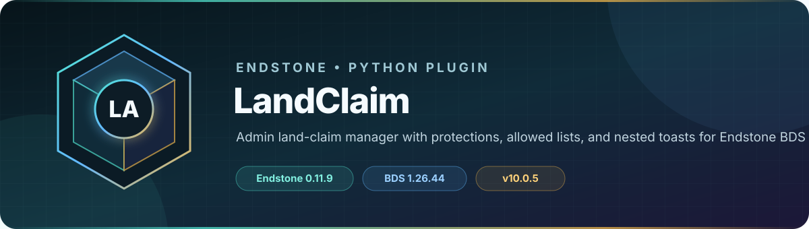

<!-- endstone-professional-header:start -->
<p align="center">
  
</p>

<p align="center">
  <a href="https://github.com/TheNINJALLO/endstone-landclaim/actions/workflows/wheel-release.yml"></a>
  <a href="https://github.com/TheNINJALLO/endstone-landclaim/releases/latest"></a>
</p>

<p align="center">
  
  
  
  =3.10" src="https://img.shields.io/badge/Python-%3E=3.10-3776AB?style=flat-square&amp;logo=python&amp;logoColor=white">
</p>

<p align="center">
  <strong>Admin land-claim manager with protections, allowed lists, and nested toasts for Endstone BDS.</strong>
</p>

<p align="center">
  <a href="#what-it-does">What it does</a> &bull;
  <a href="#how-to-use">How to use</a> &bull;
  <a href="#commands-and-permissions">Commands</a> &bull;
  <a href="#install">Install</a> &bull;
  <a href="https://github.com/TheNINJALLO/endstone-landclaim/releases">Releases</a>
</p>

## Overview

Admin land-claim manager with protections, allowed lists, and nested toasts for Endstone BDS. This release is aligned with Endstone 0.11.9 and Minecraft Bedrock Dedicated Server 1.26.44, and is distributed as a Python wheel for direct installation in an Endstone server.

## What it does

- Creates persistent administrative land claims with per-claim protection rules and allowed-player lists.
- Controls block, interaction, PvP, entity, particle, and mob behavior inside configured boundaries.
- Provides player request forms, staff management forms, notifications, and optional dashboard integration.

## How to use

1. Start once and review the generated local configuration; keep dashboard credentials and OAuth values out of Git.
2. Grant `adminlandclaims.command` to claim managers, then use `/landclaim` to create and manage protected areas.
3. Use `/requestclaim` for the request workflow and `adminlandclaims.bypass` only for trusted staff.
4. Keep the dashboard disabled unless configured securely, and bind/reverse-proxy it according to your network policy.

## Commands and permissions

| Command / usage | What it does | Access |
|---|---|---|
| `/landclaim` | Opens the land claim management UI. | `adminlandclaims.command` |
| `/requestclaim` | Request a new land claim. | `adminlandclaims.command` |
| `/lcadmin`<br>`/lcadmin notification <toast\|tip\|chat>` | Admin commands for land claim settings. | `adminlandclaims.admin` |
| `/lcdebug`<br>`/lcdebug <particles\|claims\|mobs\|killmobs\|forceparticles\|scanmobs\|countmobs>`<br>`/lcdebug testmob <mobtype>` | Debug commands for land claim testing. | `adminlandclaims.admin` |

## Compatibility

| Component | Supported version |
|---|---|
| Endstone | `0.11.9` |
| Endstone API | `0.11` |
| Bedrock Dedicated Server | `1.26.44` |
| Python | `>=3.10` |
| Plugin release | `v10.0.6` |

## Install

Download the wheel from the matching GitHub release:

```bash
gh release download v10.0.6 --repo TheNINJALLO/endstone-landclaim --pattern "*.whl"
```

Copy the downloaded wheel into the server's `plugins/` directory, remove any older wheel for the same plugin, and restart Endstone.

> [!IMPORTANT]
> Use Endstone `0.11.9` with BDS `1.26.44`. Back up worlds and plugin data before upgrading a production server.

## Configuration and secrets

Runtime databases, logs, local `.env` files, server directories, and root `config.toml` files are excluded from source releases. When an example configuration is provided, copy it locally and keep live tokens, passwords, webhook URLs, and server identifiers out of Git.

## Release automation

Every `v*` tag runs [the wheel release workflow](.github/workflows/wheel-release.yml), builds the package in a clean GitHub runner, stores the wheel as a workflow artifact, and attaches it to the matching GitHub release.
<!-- endstone-professional-header:end -->

## Dashboard configuration

Copy [`config.example.json`](config.example.json) into the plugin's generated data folder as `config.json`. Supply your own Discord application identifiers, OAuth client secret, redirect URI, allow list, and optional master password. Never commit the populated runtime file.
